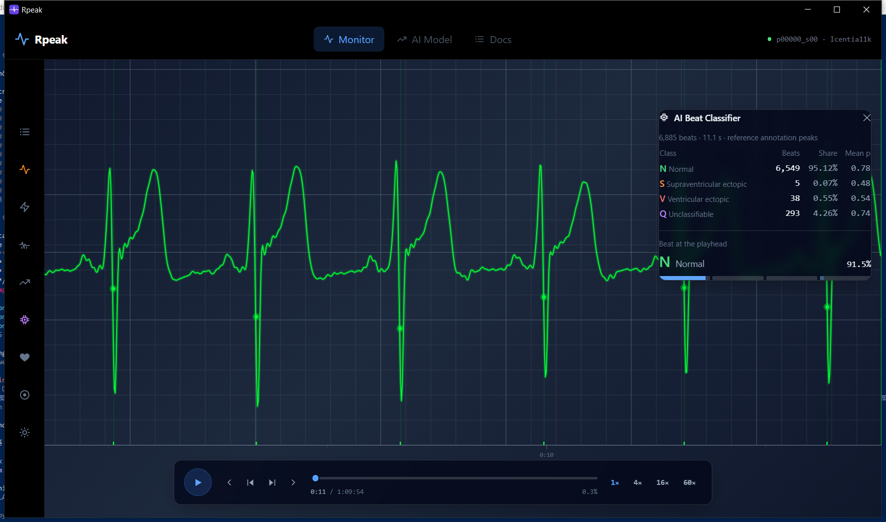

# Rpeak Desktop

A local Windows desktop app for replaying and analysing continuous ECG, built on
the PhysioNet Icentia11k dataset. It replays a 70-minute segment, detects R-peaks
live, delineates PQRST, computes HRV, classifies every beat with a small CNN, and
renders a model card and a user guide that read their figures from the
artefacts rather than from hard-coded copy. The UI ships in Vietnamese with an
English switch.

This is a rebuild of the browser demo at <https://upsidedownlabs.github.io/Rpeak/>
with the reference's defects fixed rather than reproduced — every claim in these
notes is measured, and the mistakes are written down with the numbers that
caught them.



## Quick start

```
cd app
npm install
npm run dev          # http://localhost:5173, needs ../data (see below)
```

The app reads `D:\Rpeak-Desktop\data`, which is **not** in the repository: it is
1.1 GB of downloaded Icentia11k material. `pipeline/` rebuilds it:
`download.py` → `convert.py` → `export_f32.py` → `export_app_index.py`. The full
path, and the dataset's layout, are in [docs/README.md](docs/README.md).

To run the quality gate — the one command to run before believing a change:

```
cd app
npm run gate               # twelve stages, ~46 s, no browser needed
npm run gate -- --browser  # plus five CDP smoke suites, ~89 s
```

## Documentation

| Document                                         | What is in it                                                            |
| ------------------------------------------------ | ------------------------------------------------------------------------ |
| [docs/README.md](docs/README.md)                 | Milestones G1–G16, the run recipes, the layout, dataset facts, licence   |
| [docs/app-shell.md](docs/app-shell.md)           | The shell: playback, boundaries, focus, deep links; G15 and G16          |
| [docs/detector.md](docs/detector.md)             | R-peak detection, its measured accuracy, and what was tried and rejected |
| [docs/analysis.md](docs/analysis.md)             | PQRST, HRV, intervals, session report and export                         |
| [docs/classifier.md](docs/classifier.md)         | The CNN, the ablations, the honest per-class numbers                     |
| [docs/model-and-docs.md](docs/model-and-docs.md) | The AI Model and Docs pages, and the charts                              |
| [docs/i18n.md](docs/i18n.md)                     | Vietnamese as the shipped language                                       |
| [docs/packaging.md](docs/packaging.md)           | The Tauri build, the dataset lookup, licensing                           |
| [docs/process.md](docs/process.md)               | The repository, the gate, lint and format                                |

## Licence

Code is MIT ([LICENSE](LICENSE)). The data and the model weights trained on it
carry the dataset's CC BY-NC-SA 4.0 terms — [NOTICE](NOTICE) says exactly which
covers what.
