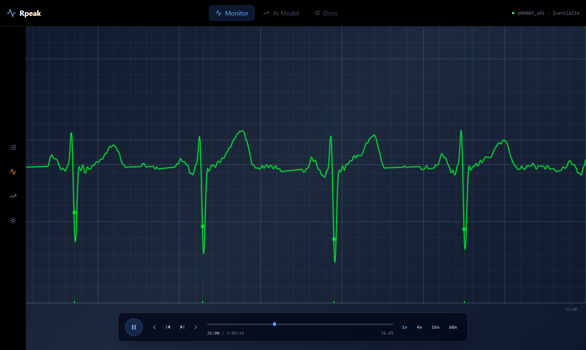
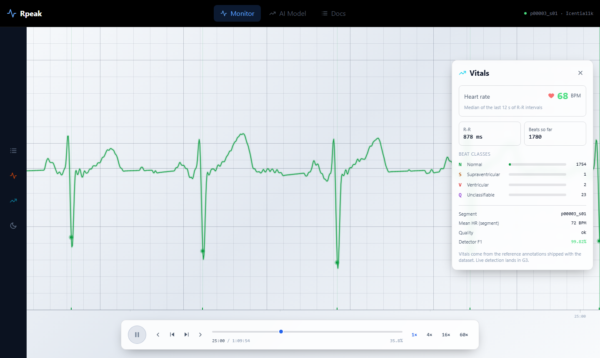
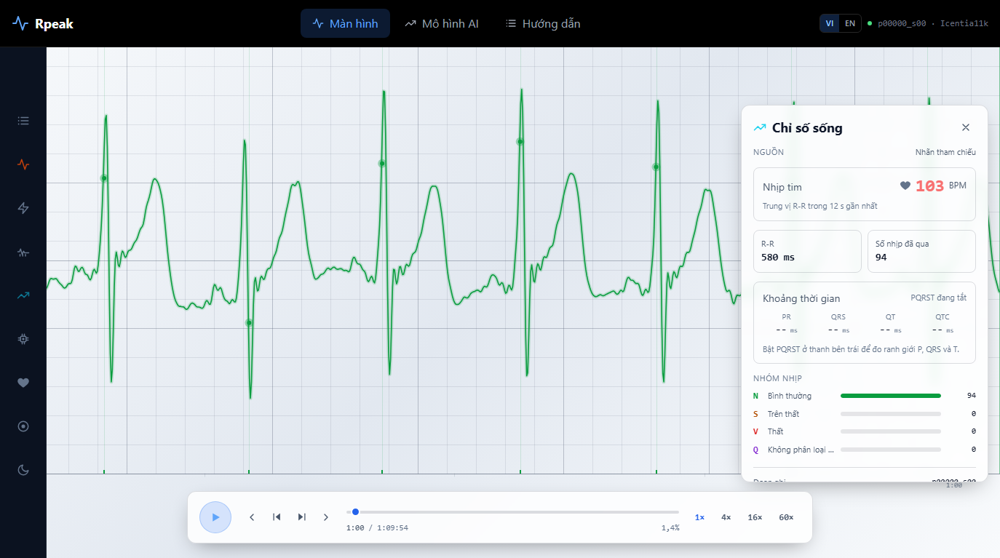
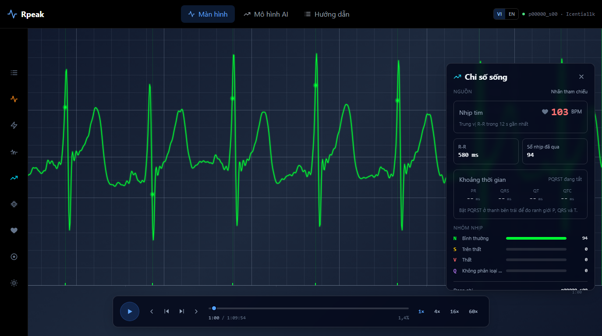

# G2 — app shell and signal replay

Status: **done**. `npm run dev` in `D:\Rpeak-Desktop\app` opens a working
monitor on the local Icentia11k subset.





## What it does

- Replays any of the 24 exported segments (12 patients × 2) at 1×/4×/16×/60×.
- Scrolls a 1,000-sample window (4 s at 250 Hz) through the display filter
  chain from `src/lib/filters.ts` — the same coefficients the Python reference
  and the offline evaluator use.
- Draws the reference beat annotations over the trace: a colour-coded dot at
  each annotated R peak, a faint tick on the baseline, and a letter for the
  clinically abnormal classes only.
- Live vitals: heart rate, R-R, beats-so-far and per-class counts, computed for
  the window at the playhead from the reference annotations — or from the live
  detector when it is switched on, with the source named in the panel.
- Optional live detection: the green "Detect R-peaks" rail toggle runs
  `detect_v4` over the whole segment in a worker (`src/lib/detect/`) and draws
  the result as hollow blue rings and top-edge triangles. One segment takes
  0.5–0.9 s (median 685 ms); the trace keeps playing while it runs. See
  [detector.md](detector.md#typescript-port-g3).
- Dark and light themes. `?theme=light` in the URL pins one for a screenshot or
  a bookmark; the rail toggle otherwise persists the choice.
- Deep links: `?record=p00004_s01&t=600&panel=stats` reopens the same segment,
  moment and panel.

## Where the reference app and this one differ

The UI is the reference's: same navbar geometry, same 64px expanding icon rail,
same translucent floating panels, same green trace on a slate gradient. Four
deliberate departures, all of them things that were broken or absent upstream:

| Reference                               | Here                                          | Why                                                                                                                                                                                                       |
| --------------------------------------- | --------------------------------------------- | --------------------------------------------------------------------------------------------------------------------------------------------------------------------------------------------------------- |
| `bg-black/60` hard-coded in every panel | `--panel-fill` variable                       | Upstream ships a `[data-theme="light"]` block, but the components ignore it, so light mode never worked. Panels also needed to be more opaque than 60% — a bright trace underneath makes text unreadable. |
| `webgl-plot` line object                | Canvas2D                                      | The grid, beat overlay and time ruler are drawn in the same pass. A WebGL line cannot draw those without extra line objects, and 1,000 points is ~0.3 ms to rasterise. Removed the dependency.            |
| Bluetooth-only, 360 Hz, 7-byte packets  | `SignalSource` interface + `FileReplaySource` | The dataset is file-based. The interface is what a live source will implement in a later milestone; nothing in the UI knows which one it has.                                                             |
| Peak labels on every PQRST point        | Beat markers from annotations                 | Upstream computes PQRST from a window of 1,000 samples with no ground truth to check against. Here the markers are the dataset's own labels, which is the only way to know the overlay is correct.        |

## The pieces

```
src/
  App.tsx                    state, keyboard, URL sync
  components/
    NavBar.tsx               fixed 64px bar
    IconRail.tsx             expanding left rail (segments / beats / detector / vitals / theme)
    WaveformCanvas.tsx       grid, trace, beat overlay, detector overlay, time ruler
    TransportBar.tsx         play, skip, beat-step, seek, speed
    SegmentPicker.tsx        patient → segment browser with per-segment F1
    StatsPanel.tsx           live vitals, annotation- or detector-sourced
    icons.tsx                the 15 glyphs used, drawn inline
    ErrorBoundary.tsx        one boundary per panel, plus the app root;
                             also exports FaultProbe, which throws on demand
  hooks/
    useLiveDetector.ts       worker lifecycle, stale-result guard
  lib/
    playback.ts              ReplayEngine: wall-clock clock, filter, ring, seek
    catalog.ts               /data URLs, segment index, annotation loading
    filters.ts               (existing) SOS chain from scipy coefficients
    quality.ts               the one place a segment's quality becomes words
    i18n.tsx                 translate, translateDetail, LocaleProvider, useT()
    detect/                  TypeScript port of detect_v4 + worker entry
    signal/
      types.ts               SignalSource, SegmentInfo, Beat
      fileReplaySource.ts    whole-segment float32 replay
      ringBuffer.ts          1,000-sample ring, NaN-padded when partly filled
      annotations.ts         binary-search beat index + RR / counts; PeakTrack for detector output
```

### Design notes worth keeping

**The clock is wall time, and the position is fractional.** Each animation
frame adds `dt × fs × speed` to a float sample position and filters only the
whole samples crossed. Snapping the position to integers makes 1× visibly
stutter at 250 Hz; carrying the fraction into the canvas x-offset makes it
smooth.

**Seeking pre-rolls the filter.** The display chain starts with a 0.5 Hz
high-pass, which takes seconds to settle. A seek filters 6 s of signal before
the target and keeps only the last 1,000 samples, so scrubbing does not produce
a transient that looks like a real waveform change.

**A partly-filled window is blank, not flat.** Right after a seek to sample 0
there are fewer than 1,000 samples to show. Padding with the oldest value drew
a flat line that read as real signal in the first screenshot; the ring pads
with `NaN` and the canvas breaks the path there.

**The canvas only repaints when something changed.** A paused dashboard
rasterising 1,000 points at 60 Hz is pure battery drain. `ReplayEngine` carries
a dirty flag, set by play/seek/speed/resize/annotation-arrival.

## The G15 change: the edges of the shell

Six defects that share a shape: each one is invisible in a screenshot, each one
is a place where the app failed _quietly_, and each now has a check that fails
if it regresses. They were found by asking what the screen does not show, not by
a bug report.

| Was                                                         | Now                                                                                       | Check                                                                        |
| ----------------------------------------------------------- | ----------------------------------------------------------------------------------------- | ---------------------------------------------------------------------------- |
| A panel that threw unmounted the whole window               | one boundary per panel, one for the page, one for the app root                            | `smoke`: fault injection, trace still lit                                    |
| `saturated` rendered raw in the vitals panel and the picker | `qualityLabel()` / `qualityTone()` in `lib/quality.ts`                                    | `smoke:lang`: reads `Bão hoà`, asserts the ASCII value is absent             |
| Escape did nothing                                          | closes whichever panel is open                                                            | `smoke`: the close button is gone                                            |
| `?record=garbage` silently opened segment 0                 | a non-fatal notice naming the segment, an "Open the list" button, the trace still playing | `smoke:pages`: the notice, the name, a live canvas, the recovery             |
| The window title was the static `Rpeak`                     | `{page} — Rpeak`, retranslated on a language switch                                       | `smoke` (EN) and `smoke:lang` (VI and EN)                                    |
| Rail labels appeared on hover only                          | `group-focus-within` as well, and a visible focus ring                                    | `smoke`: focus the button, read the label's `display` from `none` to `block` |

### The boundary, and how it is proved

`ErrorBoundary` is a class because React has no hook for it. It takes its
language as a **prop**, not from `useT()`: a boundary sits above the subtree
that threw, but if the throw came from inside the provider, reading the context
here could fail a second time.

A boundary nobody has watched catch anything is a guess, and in a release build
there is no way to make one throw without a fault injector. So `FaultProbe`
exists: a real component, mounted by `App` only under `import.meta.env.DEV`, that
throws when `window.__rpeak.fault(true)` sets a flag. `smoke.ts` arms it, waits
for `This panel stopped working`, then samples the canvas pixels and requires
non-zero lit pixels — if the boundary were missing or in the wrong place React
would have unmounted the trace with it. Then it disarms the probe and clicks
`Try again`, which must clear the fallback.

That ordering matters. The first version clicked retry with the probe still
armed and failed, which is correct behaviour for a persistent fault: the retry
remounts the tree, the probe throws again, and the reader lands back on the same
fallback rather than a blank panel. The test was wrong, not the boundary.

The per-panel `what` is translated as a sentence (`the vitals panel` →
`bảng chỉ số sống`), but the runtime's error message is printed as thrown.
Same rule as the worker diagnostics: our words are translated, JavaScript's are
not.

### The quality label

The catalogue stores `ok` / `saturated` / `low-amplitude` / `flat` /
`implausible-hr` — machine values, from `pipeline/convert.py:classify_quality`.
Two render sites each formatted them locally and drifted. `lib/quality.ts` is
the single owner: `qualityLabel` for the words, `qualityTone` for the colour
(yellow for a fixable signal problem, red for a structural one).

This was also the first string to reach the screen through a _variable_
(`t(qualityLabel(seg.quality))`), which is exactly what `check_i18n.py` cannot
verify — the dictionary entry exists and is "used", but nothing proves the render
site asks for it. The rendered check in `smoke:lang` is the only guard, which is
why it reads the label off a saturated segment rather than trusting the audit.

## The G15 run

With the dev server on 5173 and the packaged binary rebuilt:

```
python -I ../pipeline/check_i18n.py
                    434/434 keys translated, 0 unused, 0 mismatched, 93 through a variable
npm run test:i18n   15 checks passed
npx tsc --noEmit    clean
npm run build       ✓ built in 3.2s
npm test / test:detect / test:hrv / test:delineate / test:report / test:cnn
                    all passed
npm run smoke       all checks passed (27 checks, including the six new ones)
npm run smoke:pages all checks passed (59 checks)
npm run smoke:lang  all checks passed (29 checks)
npm run smoke:app   all checks passed (10 checks, rebuilt binary at 08:33,
                    6,885 beats in 6.8 s)
```

The binary mattered: the exe on disk was from the day before, and `smoke:app`
asserts against whatever is there. It was rebuilt with
`PATH="$HOME/.cargo/bin:$PATH" npx tauri build --no-bundle`, and the timestamp
was read afterwards rather than trusting the wrapper's exit code — see
[packaging.md](packaging.md#reproducing).

One check in this milestone passed on its first run for the wrong reason and was
rewritten. On the stale English-only binary, "pressing EN switches the app to
English" was green because the app was _already_ English and had no switch. The
replacement requires the packaged app to _start_ in Vietnamese and the page to
_leave_ Vietnamese when EN is pressed. A check that cannot fail is not a check.

## The G16 change: panels as dialogs

Five panels — stats, HRV, report, classifier, segment picker — were plain
floating `div`s. They looked right and were not a dialog to anything that reads
the accessibility tree: no role, no label, Tab walked out into the page behind,
and closing one dropped focus to the body.

They now render through one `components/Panel.tsx`:

```tsx
<div ref={ref} role="dialog" aria-modal="true" aria-labelledby={titleId}
     tabIndex={-1} data-panel={testId} onKeyDown={onKeyDown} className={...}>
```

The component owns three behaviours and deliberately refuses two:

| It does                                          | Because                                                                                   |
| ------------------------------------------------ | ----------------------------------------------------------------------------------------- |
| `aria-labelledby` via `useId()`                  | the heading is the accessible name, and two panels on one page must not share an id       |
| a Tab / Shift+Tab trap                           | the reader should not tab into a page they cannot see                                     |
| focus in on mount, back to the opener on unmount | the opener is captured as `document.activeElement`, and returned to only if `isConnected` |

| It does not                   | Because                                                                                                                                   |
| ----------------------------- | ----------------------------------------------------------------------------------------------------------------------------------------- |
| handle Escape                 | `App`'s window key handler already closes the open panel; a second handler would close two, or race the first                             |
| set `aria-hidden` on siblings | `aria-modal` is the declaration; a stale `aria-hidden` on an ancestor hides the whole app from assistive technology when the panel closes |

`smoke` now asserts the dialog: the role and label are present, no ancestor is
`aria-hidden` (walking the parent chain, not counting globally — decorative
icons set it legitimately), Tab wraps in both directions on the panel with
enough focusable nodes to test (Segments: 24 rows plus close), and closing
returns focus to the button that opened it.

The same panel in both themes, from the build that carries the G16 contrast
fixes — the light theme's faint text and the chart cursor line were the two
tokens that failed WCAG before this milestone (see
[process.md](process.md#the-light-theme-measured)):

| Light                                                        | Dark                                                       |
| ------------------------------------------------------------ | ---------------------------------------------------------- |
|  |  |

The checks taught the same lesson as G15's: three of the first four failures
were in the test, not the panel — a frame's delay before React commits, an
opener that was never focused, and two panels opened and closed in one
`evaluate` so the first one's focus restore landed last. Each is described in
[process.md](process.md#panels-are-dialogs).

## Verification

`npm run test` — 13 assertions on the ring buffer, the annotation index and the
source contract. These are the parts where a silent bug produces a plausible
but wrong trace.

`npm run smoke` — drives the running dev server over the Chrome DevTools
Protocol and asserts behaviour a screenshot cannot:

```
ok   segment loads
ok   fs is 250
ok   duration is one Icentia11k segment
ok   1x advances about 1 s of signal per second
ok   16x advances about 16x faster
ok   pause freezes the position
ok   seek lands on the requested sample
ok   seek fills the whole window
ok   the window holds real signal, not silence
ok   a fresh start leaves the window blank rather than drawing a flat line
ok   the 0.5 Hz high-pass removes the baseline
ok   the display chain keeps QRS amplitude in a sane range
ok   detector toggle engages
ok   the detection worker returns without error
ok   the worker finds the expected number of beats
```

The last three fail if the worker module fails to load or the port drifts: the
page reports the detector's peak count, which must equal the 6,886 that Python
and `npm run eval` produce for p00000_s00.

The seek check is exact (`1800 s × 250 Hz = 450,000`) because an off-by-one in
the window arithmetic shifts every beat marker and is invisible in a still.

`smoke` has since grown to 31 checks; G16's four dialog checks join G15's tail:

```
ok   a render error is caught by its panel's boundary
ok   the rest of the app keeps rendering behind the fallback
ok   Try again recovers once the fault is gone
ok   a rail button opens its panel
ok   Escape closes the open panel
ok   a panel declares itself a modal dialog
ok   nothing above the dialog hides it from the accessibility tree
ok   Tab stays inside the dialog in both directions
ok   closing returns focus to the control that opened it
ok   the rail's labels appear when a button takes keyboard focus
ok   the title names the monitor
ok   the title follows the page
```

`smoke:lang` is 30 checks, `smoke:theme` 20, `smoke:pages` 59, `smoke:app` 10.
The full gate — twelve stages without a browser, seventeen with — is
`npm run gate`; see [process.md](process.md).

## Data path

`vite.config.ts` mounts `D:\Rpeak-Desktop\data` at `/data` with a small
middleware: path traversal is rejected, byte ranges are honoured, and nothing
is copied into the build. `pipeline/export_app_index.py` flattens
`catalog.sqlite` plus the detector scores into `catalog/segments.json`
(11 KB), which is what the picker reads.

## Disk

D: 15.0 GB free. `app` 100 MB (99 MB of it `node_modules`), `data` 167 MB
(97 MB f32 segments, 15 MB detector goldens), `.cache` 219 MB (the npm cache
and two headless-browser profiles). Nothing here grows with playback: the
largest allocation is one 4 MB segment in a `Float32Array`, plus the worker's
copy while a detection runs. The goldens and `.cache` are the disposable parts
if space ever gets tight.

## Known gaps, deliberately left for later milestones

- Detection is whole-segment, not streaming: switching segments re-runs it
  (0.5–0.9 s in a worker). A streaming detector would need a different
  algorithm, not a faster port, because the selection DP is global.
- PQRST/HRV/session recording and the AI panel landed in G4 and G5; packaging in
  G6; the AI Model and Docs pages in G7. See [analysis.md](analysis.md),
  [classifier.md](classifier.md), [packaging.md](packaging.md) and
  [model-and-docs.md](model-and-docs.md).
- The segment picker lists all 24 catalogued segments on one scroll. Fine for
  12 patients; needs grouping/filtering when the set grows past a few hundred.
