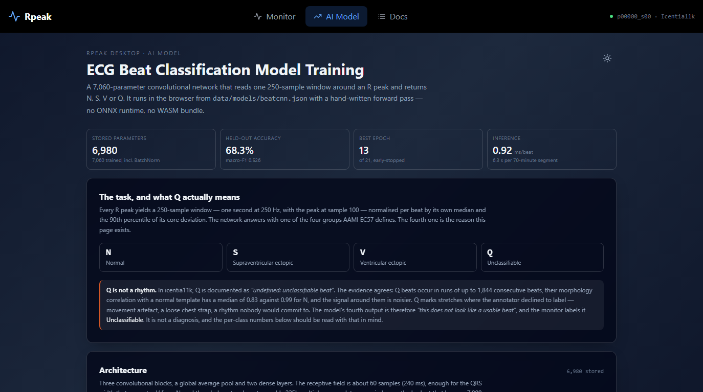
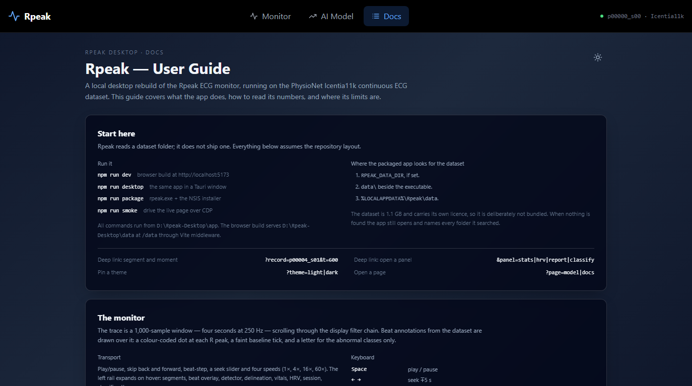

# G7 — the AI Model and Docs pages

Status: **done**. The two navbar entries that had been placeholders since G2 are
live, and the app is now feature-complete against the reference's navigation:
Monitor, AI Model, Docs.





## What was missing, and why it mattered

`NavBar` had rendered "AI Model" and "Docs" as `disabled` buttons with
`title="Coming in a later milestone"` since G2. Everything the reference app
shows under `/train` and `/docs` existed in this project's artefacts — the
training history, the confusion matrices, the per-patient evaluation, the parity
evidence, the detector scores — but none of it was reachable from the UI. The
data was in `data/models/*.json` and `docs/*.md`, and the app is what people
open.

Two things follow from that, and they shaped the design:

1. **Every number on these pages is read from the artefact that produced it.**
   Nothing is typed in from a notebook or copied out of `docs/classifier.md`.
   Retraining the model changes the page on the next load, with no edit here.
2. **The parity table is computed in the browser.** The AI Model page runs the
   app's own TypeScript forward pass over the eight windows PyTorch scored, as
   it renders. That is the same check `npm run test:cnn` performs, shown to the
   reader instead of asserted in a terminal.

## Navigation

`App.tsx` gained a `page` state: `monitor` (default), `model`, `docs`, mirrored
into the URL as `?page=model|docs`. The monitor's own state — engine, source,
panels, detector and classifier results — stays mounted; switching pages hides
it rather than tearing it down, so coming back does not reload a 4 MB segment.

Three behaviours the smoke test pins, because each is a bug if wrong:

| Behaviour                                                  | Why                                                                                                       |
| ---------------------------------------------------------- | --------------------------------------------------------------------------------------------------------- |
| Leaving the monitor pauses playback                        | A 70-minute replay running behind a static page is pure battery drain.                                    |
| Returning resumes **only if it was playing when you left** | Resume-on-return is a convenience; auto-playing a monitor the user had deliberately paused is a surprise. |
| `Space` / arrows do nothing while a page has focus         | The transport keys are global; without a guard they drive a replay nobody is watching.                    |

The first attempt at the resume flag got this wrong: it recorded
`engine.isPlaying` on _every_ navigation into a page, so Model → Docs
overwrote "was playing" with the "paused" state its own navigation had caused,
and Monitor never resumed. `smoke-pages.ts` caught it — the check
`the monitor resumed because it was playing when we left` failed on the first
run. The flag is now only set when the _source_ page is the monitor.

## The AI Model page

Sections: task and the meaning of Q, architecture, whether the model uses its
extra input (the ablation), training, held-out evaluation, per patient, parity,
inference cost, limits.

**The parameter count is stated as two numbers, because there are two.**
`docs/classifier.md` and `pipeline/train_cnn.py` say 7,156; the exported
`beatcnn.json` holds 7,076. Both are right, and they count different things:

```
conv weights   1·16·5 + 16·32·5 + 32·32·3   = 5,712   (bias-free while training)
BatchNorm      2·(16 + 32 + 32)              =   160   trained, folded at export
dense head     35·32+32 + 4·32+4             = 1,284
                                               ------
trained in PyTorch                              7,156   ← what count_params reports
conv bias added at export  16+32+32          =   +80   (BN shift, folded)
                                               ------
stored in beatcnn.json                          7,076
```

The arithmetic closes exactly, and it explains the sign: folding BatchNorm into
a bias-free convolution **adds** one bias per output channel, while removing the
two BatchNorm values per channel. Net −80. `pipeline/cnn_model.py` builds the
convolutions with `bias=False` for this reason, and `cnn_export.py` does the
fold, so the runtime executes 7,076 values for a network that trained 7,156 —
the same function, since BN's shift absorbs the new bias exactly. The parity
test confirms it.

The head's input is 35 rather than 32 because the pooled vector is concatenated
with the three standardised timing ratios (G9). The previous model took
`log(scale)` there instead, and the ablation showed it was ignored; that column
is gone, and its 7,092 / 7,012 arithmetic is in the G8 section below.

So the page shows the derivation rather than picking a number:

- **7,156** trained.
- **7,076** stored and executed, the same function.

The architecture table computes both from the exported tensors, so a future
export that keeps the biases will show the split honestly rather than silently
changing the headline.

### The charts

Three forms, each chosen for the job the data has to do:

| Chart                            | Form                                           | Why                                                                                                             |
| -------------------------------- | ---------------------------------------------- | --------------------------------------------------------------------------------------------------------------- |
| Training loss                    | line, 21 points, best-epoch marker             | Change over time, one series — the shape _is_ the story.                                                        |
| Validation accuracy and macro-F1 | line, two series, one y-axis                   | Two measures on the same 0–1 scale, so they share an axis legitimately.                                         |
| Confusion matrix                 | table with a one-hue wash, counts/row-% toggle | The exact cells are the content; shading only ranks them. A heatmap would be the same thing with worse numbers. |
| F1 by class                      | horizontal bars, value at the tip              | Four magnitudes against a 0–1 ceiling.                                                                          |
| Per patient                      | table                                          | Six rows of four-class detail; a chart would hide the `—` cells that matter.                                    |

Colour follows the dataviz method rather than the app's UI tones: the two-series
pair is `--series-1` / `--series-2`, validated against **both** page surfaces —
`#3987e5` / `#d95926` on `#0f172a` (dark) and `#2a78d6` / `#eb6834` on
`#ffffff` (light). Both runs pass the lightness band, chroma floor, CVD
separation (ΔE 26.8 / 24.7 protan), normal-vision separation (31.8 / 33.6) and
3:1 contrast. The app's existing UI tones were tried first and fail: `#54a2ff`,
`#ff8b1a`, `#00d2ef` on `#0f172a` break the lightness band, and `#0e7490` on
white breaks the chroma floor.

The confusion matrix is one hue at varying opacity, capped at 40%, with a
square-root ramp — a linear one makes every off-diagonal cell look the same
near the top of the scale. Text stays in text ink; the wash only ranks.

## The Docs page

The reference's `/docs` is a user guide; this one is written against what _this_
build does. The differences are the point:

| Reference                   | Here                                                                                     |
| --------------------------- | ---------------------------------------------------------------------------------------- |
| Bluetooth device pairing    | A file-based replay of a local dataset, with the packaged app's search order spelled out |
| Five AAMI classes           | Four — icentia11k has no F class                                                         |
| Q as a rhythm               | Q as _unclassifiable_, with the evidence                                                 |
| Feature counts, no accuracy | Detector Se/PPV/F1 per segment and per patient, and the classifier's per-class numbers   |

Sections: start here (commands, dataset search order, deep links), the monitor
(transport, keyboard), analysis tools (six cards), understanding the numbers,
performance, dataset and licence, limits. A numbered contents list at the top
links to each one and bolds the one you are reading (G11).

The numbers section pairs a dot plot with the full table it draws from: Se and
PPV per patient on one 85–100% axis, two dots per row, legend present, hover
tooltips on hit targets larger than the marks. The table underneath is the
accessible twin — a screenshot of the plot would show that p00006 is the
outlier, the table shows it is Se 94.16 / PPV 87.90.

### The percentage bug this caught

`data/catalog/eval_result.json` stores detector scores **already scaled to
percent** (`97.73385955…`), while `data/models/beatcnn.eval.json` stores
fractions (`0.6827529…`). The first render formatted both with the same
`pct()` helper and the Docs page led with **9773.39%** sensitivity. It was
visible in the first screenshot, and `smoke-pages.ts` now asserts the string
`9773` never appears. Two artefacts, two conventions, one formatter — the
failure mode is a page that looks confident and is off by 100×.

## Verification

`npm run smoke:pages` — 59 checks over CDP against the live page:

```
ok   monitor loads
ok   the AI Model entry is enabled
ok   the AI Model page finishes reading its artefacts
ok   the model page renders its title
ok   it states the stored parameter count
ok   it states the trained parameter count too
ok   it shows the held-out accuracy
ok   it names the selected epoch
ok   the confusion matrix renders its worst cell
ok   the parity table agrees on every window
ok   every held-out patient is listed
ok   the N/Q boundary section shows the swept cell
ok   it states the best biased macro-F1
ok   it reports how many checkpoints the rule helps
ok   it says the rule is not shipped
ok   no artefact failed to load
ok   the training charts drew their series
ok   every section has a table-of-contents entry
ok   the contents list starts on the first section
ok   clicking a contents entry scrolls the pane
ok   it leaves the heading just below the navbar
ok   the contents entry becomes current
ok   the URL names the section
ok   the line chart takes focus
ok   it describes its keys to a screen reader
ok   Home puts the cursor on the first epoch and reads it out
ok   End puts the cursor on the last epoch
ok   the readout says which epoch of how many
ok   Escape clears the cursor and the readout
ok   the monitor stopped playing behind the page
ok   the URL carries the page
ok   the Docs entry is enabled
ok   the Docs page finishes reading its artefacts
ok   the guide renders its title
ok   it reports the detector's sensitivity
ok   it reports the detector's PPV
ok   it does not double-scale the detector percentages
ok   the per-patient dot plot drew two dots per patient
ok   the dot plot takes focus
ok   the down arrow steps to the next patient
ok   the right arrow steps from Se to PPV on the same patient
ok   the doc plot marks the cursor it is on
ok   Page Down jumps ten patients, not one
ok   Home returns to the first patient from anywhere
ok   the readout says where the cursor is in the list
ok   the tooltip shows the same position
ok   the key hint mentions the ten-row jump
ok   no artefact failed to load
ok   the guide links to the model page
ok   the link lands on the model page
ok   the Monitor entry navigates back
ok   the monitor resumed because it was playing when we left
ok   the URL no longer carries a page
ok   a paused monitor stays paused when you come back
ok   space does not start the replay from a documentation page
```

Two of these were written after a real failure, not in advance: the resume check
failed on the first run, and the chart-count checks failed intermittently until
they polled — the SVG charts render nothing until their `ResizeObserver` reports
a width, which is the same race the packaged-app smoke test hit with the canvas.

`npm run smoke:app` gained two checks for the shipped binary: both pages open and
render a number that can only come from the IPC-read artefacts (`7,076` on the
model card, the guide's title on Docs). A page whose JSON failed to load still
renders its shell, so "the page opened" would have proved nothing.

```
ok   the packaged app renders the AI Model page
ok   the packaged app renders the Docs page
```

The page-ready hook is `[data-page-ready]`, set once the artefacts are in.
`scripts/shot.ts --page model|docs [--scroll N]` uses it, so a screenshot
cannot capture the "Reading the model artefacts…" state and pass as a page.

Also re-run after the change, all passing: `npm test`, `npm run test:cnn`,
`npm run smoke` (which still classifies 6,886 beats in 6.19 s and finds
6,886 detector peaks).

## The G8 change to this page

The ablation section is the one thing on the page that reports a _negative_
result, and it is there because the alternative was worse. The previous version
of `classifier.md` proposed `log(scale)` as the fix for N → Q; the retrain added
it, macro-F1 rose 0.526 → 0.578, and it would have been easy to ship that as the
feature working. The ablation — same weights, constant or shuffled input — shows
the column is inert, and the control run shows the old model reproducing
exactly, which leaves run-to-run variance as the explanation for the gain.

So the page states the ablation and the three runs rather than claiming a
victory. `beatcnn.ablate.json` is a pipeline artefact like the others; the page
reads it and, if it is missing, says which command writes it instead of
pretending the section is not there.

Two figures moved with the retrain and are now derived rather than typed:
`smoke-pages.ts` reads the stored parameter count, the trained count, the
held-out accuracy, the best epoch and the N → Q cell out of the artefacts before
asserting the page shows them. They were literals before, which meant the test
would have failed on every retrain for the wrong reason — and would have passed
if the page and the test drifted together.

## The G9 change to this page

The same ablation section now reports an _accepted_ result, and the page did not
need a new section to say so: the verdict is computed from the ablation's own
rows. `cue.used` is `real.macro_f1 − min(zero, shuffle) > 0.02`, so the shipped
`beatcnn.ablate.json` — real 0.5965, zero 0.5094, shuffle 0.4469 — renders "The
network uses it." with a loss of 0.150, and a `log(scale)` file would render the
G8 branch instead. The per-column rows (`zero pre_ratio`, `zero post_ratio`,
`zero sum_ratio`) appear only because the model has three extras; the table
gained them without a conditional, since it iterates whatever rows the file has.

Everything else on the page that names the input is driven by `extraInfo`, read
from `beatcnn.json`'s `extra` block: the architecture lede, the Concat and Head
chips, the "Extra input" KV row, and the subtitle. The subtitle used to hardcode
"plus the log of the window's own amplitude" — true for G8, false for G9 — and is
now `extraInfo.lede`. The retrain note under the runs table is conditional too:
for G9 it says the ablation is the evidence and the runs are context, because
the two now point the same way; for G8 it kept the "this spread is variance"
warning.

Three typed figures had to change and are still typed: inference cost (0.95–1.3 ms
per beat, 6.5–9.1 s per segment), the model file size (197 KB) and the AUC values
in the cue note. They come from measurements that are not in any artefact, so the
page cannot derive them; the figures in the smoke test, which _can_ be derived,
are derived.

## The G10 change to this page

G10 needed a new section rather than a new row, because it reports a rule the app
does not use. "The N → Q boundary, measured and not shipped" sits between
inference cost and limits, and it is the third result in a row whose verdict the
page derives instead of asserts:

| milestone | artefact                                            | what the page says                              |
| --------- | --------------------------------------------------- | ----------------------------------------------- |
| G8        | `beatcnn.ablate.json`, `log(scale)` rows            | the network ignores it                          |
| G9        | `beatcnn.ablate.json`, `rr` rows                    | the network uses it                             |
| G10       | `beatcnn.qboundary.json` + `beatcnn.qtransfer.json` | the boundary moves, the score does not transfer |

The G10 section has one rule it has to obey: it may not show the pooled gain
without the transfer table. That is exactly the mistake G8 caught — a promising
retrain, a plausible explanation, and a measurement that only appeared after the
claim had been written down. The two tables are rendered from two artefacts by
the same component, and the "Checkpoints it helps" tile reads `2 / 4` from the
transfer file, so a future model that the rule _does_ help across the board would
change the tile and the sentence together.

Four smoke checks pin it, each against a figure read from the artefact rather
than typed: the swept N→Q cell (5,521), the best biased macro-F1 (`0.597 →
0.625`), the checkpoint count (`2 / 4`), and the presence of "not shipped". The
last one is the important one — it fails if anyone renders the gain and forgets
the verdict.

### The cache bug this found

The first capture of the new section showed the _old_ sweep: the q-only table
that `probe_q_boundary.py` used to write, with macro-F1 rising at −2.00. The file
on disk was correct and the dev server served it correctly; curl proved both. The
cause was the persistent Edge profile at `.cache/edge-shot`, whose HTTP cache
survived the file rewrite and replayed the previous JSON to the page.

That was not only a screenshot problem. `smoke-pages.ts` used the same pattern —
a persistent profile, no cache control — so the four new checks were comparing a
page against a file it had not necessarily read. Both scripts now call
`Network.setCacheDisabled` and reload with `ignoreCache` before asserting
anything. This is the same class of failure as the stale-profile flake recorded
after the G9 model swap: a test that can pass on yesterday's data is worse than a
test that fails.

## The G11 change: the pages became navigable

Two gaps had been on the not-done list since G7, and both were about _reaching_
a figure rather than computing it.

**A table of contents.** Both pages are now long enough that the only way to a
section was to drag the scrollbar and watch for a heading. `PageShell` takes an
ordered `sections` list and renders it as a numbered list above the content. The
list is caller data, not scraped from the DOM, so a section that exists and a
section that is reachable cannot drift apart; `smoke-pages` asserts the rendered
count against the model page's ten.

Clicking an entry scrolls the **pane**, not the window — the pane is the scroll
root under the fixed navbar, and `scroll-margin` on a section does not help when
there are two scroll roots. The jump leaves the heading 12 px below the top
(`JUMP_GAP`), pushes the section into the URL so it can be linked, and the
browser's back button undoes it. A deep link (`?page=docs#numbers`) lands once
the page has rendered, because the sections live inside the `ready` branch.

The scroll spy that bolds the current entry had a bug the smoke test caught on
its first run: it measured the heading offsets once at mount. At mount the pane
is showing the loading branch, so no section existed and every offset was
`Infinity`; the pane's own box does not change when the content arrives, so the
`ResizeObserver` never corrected it. The first click therefore highlighted
nothing — `jump()` set the entry optimistically and the first scroll event erased
it. The spy now measures per frame (ten `offsetTop` reads, no cached array) and
also watches the _content_ element, which is what actually resizes. A second
check failed for a different reason: at the top of the page nothing had crossed
the threshold yet, so the list was blank. The first section is now named when no
heading has been passed.

**Keyboard access to the charts.** `LineChart` and `DotPlot` were `role="img"`
with an `aria-label` and a table twin — readable, but not navigable: a keyboard
user could not put the cursor on a point. Both SVGs now take focus (`tabIndex=0`)
and step a cursor that is an _index into the data_, not a pixel, so the same
chart drawn at 400 px and 1200 px steps through the same values.

| key               | LineChart          | DotPlot                        |
| ----------------- | ------------------ | ------------------------------ |
| ← → ↑ ↓           | step one point     | step one measure / one patient |
| Shift + step      | ten points         | —                              |
| PageUp / PageDown | ten points         | —                              |
| Home / End        | first / last epoch | first / last patient           |
| Escape            | clear              | clear                          |

The cursor is announced through an `aria-live="polite"` region whose text is the
same string the tooltip shows (`"10 · epoch: Acc 72.7%, F1 59.7%"`), because the
tooltip is a visual element and a `role="img"` chart does not expose it. Each
chart also has a hidden `aria-describedby` sentence naming its keys, which is
what makes the control discoverable without a legend. The DotPlot draws a ring
around the point the cursor is on; the LineChart's crosshair and dots are the
same marks its mouse hover already drew.

Eleven smoke checks pin the behaviour: four for the contents list (count, initial
entry, the jump landing 12 px below the navbar, the URL hash) and seven for the
keyboard (focusability, the described-by sentence, Home/End/Escape on the line
chart, and arrow-step plus the visible ring on the dot plot). The "first entry is
current" check is the one that caught the top-of-page bug.

## The G13 change: the charts say where you are, and long lists are reachable

G11 left two things on the not-done list, and both were about a chart's _reading
order_ rather than its drawing: a screen-reader user heard one value per keypress
with no idea where in the list they were, and reaching row 30 of a forty-row
per-patient table meant pressing Down thirty times (Shift-arrow jumped ten in the
line chart but had no counterpart in the dot plot, because Up/Down there already
mean "change row" rather than "jump").

**A position readout.** `Tip` gained an optional `position`, and `readout()`
appends it in parentheses, so the same string the tooltip shows is what the live
region speaks:

```
p00002: PPV 96 (3 of 12)
```

Both charts fill it — the line chart from its point index and its length, the dot
plot from the row index and the row count — and the tooltip renders it as a third,
dimmer line. A sighted reader can see a row label on the axis; the number is for
the listener, and it also answers "how much is left" without a separate
announcement.

**One keyboard model instead of two.** The dot plot's Up/Down used to be
hand-written `Math.min`/`Math.max`, which is why it had no Shift or PageUp/PageDown
step. Row movement now goes through the same `stepKey` the line chart uses, so
both charts answer to the same keys; Left/Right keep their separate meaning (which
_measure_ is read, not which row). The described-by sentence gained the new keys
in both charts. `stepKey` already handled PageUp/PageDown, so this was wiring, not
new logic — which is the point: a control a reader has already learnt should not
need relearning on the next chart.

| key               | LineChart          | DotPlot              |
| ----------------- | ------------------ | -------------------- |
| ← →               | step one point     | step one measure     |
| ↑ ↓               | step one point     | step one row         |
| Shift + ↑ ↓ / ← → | ten                | ten                  |
| PageUp / PageDown | ten                | ten                  |
| Home / End        | first / last epoch | first / last patient |
| Escape            | clear              | clear                |

**Six smoke checks pin it** (49 → 55): the line chart's readout ends with
`(18 of 18)` at End, and on the dot plot — PageDown from the first patient lands on
`p00011`, Home returns to `p00000` from that row, the readout ends with `(1 of 12)`,
the tooltip's position line agrees, and the described-by sentence names the
ten-row jump. The PageDown check is the one that would have failed before this
milestone: the old handler had no case for it and the cursor stayed put.

The screenshot below is the dot plot with the cursor placed by keyboard alone
(Down, Down, Right), so what it shows is reachable without a mouse.

## The G14 change: the pages are read in Vietnamese

The model card and the guide were the hardest part of translating the app,
because their prose is generated from artefacts: a heading like "Held-out
evaluation", a row label like "Optimiser", a per-class meaning like "Premature"
all arrive as _props_ on `Section`, `PageShell` and `KV`, which translate them
internally. The static audit reads `t("...")` calls and so cannot see any of
them; it reported 100% coverage while ten headings and the whole contents list
still rendered in English.

The findings, in the order they were found, and what fixed each:

| Symptom                                      | Cause                                                       | Fix                                               |
| -------------------------------------------- | ----------------------------------------------------------- | ------------------------------------------------- |
| Contents list and section headings English   | passed as `title`/`s.title` props                           | entries added; `smoke-lang` now asserts them      |
| Architecture row labels English              | `t(r.op)` at render, strings built untranslated in the memo | translate at construction, `t` in the memo's deps |
| `72.7%` in Vietnamese prose                  | module-level `pct` could not see the locale                 | moved into the component over `num()`             |
| "Tích chập 1" wrapping and lifting every row | Stage column at `w-16`                                      | widened to `w-24`                                 |
| Per-class meanings English                   | `CLASS_MEANING[c]` rendered raw                             | `t(CLASS_MEANING[c])`                             |

Every figure on both pages still comes from the artefacts; only the words around
them changed. See [i18n.md](i18n.md) for the design and the checks, including
why the prop-translated failure needed a rendered diff rather than a smarter
regex.

## Screenshots

| File                              | What                                                                                             |
| --------------------------------- | ------------------------------------------------------------------------------------------------ |
| `shots/g7-model-dark.png`         | AI Model, top: stat tiles and the Q explanation                                                  |
| `shots/g7-model-arch.png`         | architecture diagram, parameter table and the trained/stored derivation                          |
| `shots/g7-model-train.png`        | training curves, hyperparameters, class weights                                                  |
| `shots/g7-model-eval.png`         | confusion matrix, per-class table, per-patient table                                             |
| `shots/g7-model-parity.png`       | parity table computed in the browser, inference cost                                             |
| `shots/g7-model-limits.png`       | what the model still cannot see                                                                  |
| `shots/g7-model-light.png`        | light theme, architecture                                                                        |
| `shots/g8-model-cue.png`          | G8: the ablation section — does the network use log(scale)?                                      |
| `shots/g8-model-runs.png`         | G8: the ablation table and the three retrains side by side                                       |
| `shots/g9-model-cue.png`          | G9: the same section now reporting "The network uses it." with the per-column rows               |
| `shots/g9-model-arch.png`         | G9: the architecture with the three RR ratios on the Concat chip                                 |
| `shots/g9-model-parity.png`       | G9: training hyperparameters naming the RR ratios as the extra input                             |
| `shots/g9-model-limits.png`       | G9: inference cost re-timed, and the limits rewritten around what the ratios did and did not fix |
| `shots/g9-docs-cost.png`          | G9: the Docs performance table with the re-timed classifier and the RR-classifier limits line    |
| `shots/g10-model-boundary.png`    | G10: the N/Q bias sweep and the four stat tiles, including "2 / 4"                               |
| `shots/g10-model-transfer.png`    | G10: the transfer table, the verdict, and the rewritten limits                                   |
| `shots/docs-toc.png`              | G11: the contents list at the top of the guide, first entry current                              |
| `shots/docs-toc-light.png`        | G11: the same list in the light theme                                                            |
| `shots/model-chart-keyboard.png`  | G11: the validation chart with the cursor placed by keyboard alone (Home, then two Lefts)        |
| `shots/g13-dots-cursor.png`       | G13: the Docs dot plot with the keyboard cursor and its "3 of 12" position line                  |
| `shots/g13-line-position.png`     | G13: light theme, the training-loss chart paused on epoch 2 with "2 of 18" in the tooltip        |
| `shots/g14-vi-monitor.png`        | G14: the monitor in Vietnamese, its shipped default                                              |
| `shots/g14-vi-model.png`          | G14: the model card in Vietnamese, contents list and stat tiles                                  |
| `shots/g14-vi-model-arch.png`     | G14: the architecture table with Vietnamese row labels                                           |
| `shots/g14-vi-model-train.png`    | G14: training curves in Vietnamese                                                               |
| `shots/g14-vi-docs.png`           | G14: the guide in Vietnamese                                                                     |
| `shots/g7-docs-dark.png`          | Docs, top                                                                                        |
| `shots/g7-docs-tools.png`         | analysis tools and the start of the numbers                                                      |
| `shots/g7-docs-numbers.png`       | dot plot and per-patient table                                                                   |
| `shots/g7-docs-classes.png`       | classifier table and the link to the model page                                                  |
| `shots/g7-docs-bottom.png`        | performance, dataset, limits                                                                     |
| `shots/g7-docs-light.png`         | light theme                                                                                      |
| `shots/g7-docs-light-numbers.png` | light theme, the dot plot and the validated palette                                              |
| `shots/g7-monitor-dark.png`       | the monitor, with all three navbar entries live                                                  |
| `shots/g7-monitor-light.png`      | the monitor, light theme                                                                         |
| `shots/g7-model-phone.png`        | 430 px wide: the navbar keeps all three entries, labels collapse to icons                        |
| `shots/g7-docs-phone.png`         | 430 px wide: the dot plot and stat tiles reflow                                                  |
| `shots/g7-desktop-docs.png`       | the **packaged** app (rpeak.exe), Docs page, captured over CDP                                   |

## Files

```
app/src/pages/
  ModelPage.tsx      the model card; derives every number from data/models/
  DocsPage.tsx       the user guide; reads catalog/eval_result.json
  PageShell.tsx      header, theme toggle, contents list + scroll spy, scroll pane
  charts.tsx         LineChart, DotPlot, BarList, ConfusionMatrix, StatTile,
                     the shared keyboard cursor
  useJson.ts         one-shot dataset read
app/scripts/
  smoke-pages.ts     the 59 CDP checks above
  smoke-lang.ts      the Vietnamese build: default, switch, persistence, numbers
  test-i18n.ts       15 headless checks on the language layer
  shot.ts            gained --page and --scroll
app/src/lib/
  i18n.tsx           translate, translateDetail, LocaleProvider, useT()
  i18n.vi.ts         chrome and guide dictionary
  i18n.vi.model.ts   model-card dictionary
app/src/
  App.tsx            page state, URL mirror, pause/resume, keyboard guard
  components/NavBar.tsx   the two entries enabled
  index.css          --series-1/-2, --chart-grid, --chart-axis per theme;
                     .chart-focusable for the keyboard ring
```

## Not done

- **Nothing is announced inside a chart's own reading order beyond the cursor
  text.** G13 added the "3 of 12" position to both charts, so a listener now
  knows where the cursor is and how much is left; what is still missing is a way
  to _name_ a row ("jump to p00007") without stepping to it. With twelve patients
  that is End plus a step back; at forty it would want a jump field.
- **The contents list is a flat list.** Ten entries fit; at twice that it would
  need grouping, and the scroll spy would want a "you are here" bar rather than
  bolding.
- **The model page has no "retrain" affordance.** It is a card, not a console;
  training stays in `pipeline/`.

## Regression run

The G8 run, on the dev server and on the packaged binary:

```
npm test            all shell checks passed
npm run test:detect all stages match the Python reference
npm run test:hrv    all HRV statistics match the Python reference
npm run test:delineate  matches the synthetic golden
npm run test:report session report and exports match the data they describe
npm run test:cnn    PASS (8/8 argmax, worst |dlogit| 4.0e-6)
npm run smoke       all checks passed (6,886 peaks, 6,886 beats in 5.4 s)
npm run smoke:pages all checks passed
npm run smoke:app   all checks passed
npm run build       ✓ built in 2.9 s
```

`smoke:pages` earned its keep in this milestone: after the retrain it failed with
`every held-out patient is listed -- 5 rows`, because the per-patient table
rendered `p0019` for `p00019` — `p00` concatenated with a patient number that is
not always three digits. The page now pads the id. That is the kind of defect a
screenshot cannot catch and a literal-marker smoke test would have missed, since
the table still had six rows.

The G9 run, after the model changed underneath the page:

```
npm test            all shell checks passed
npm run test:detect all stages match the Python reference
npm run test:hrv    all HRV statistics match the Python reference
npm run test:delineate  matches the synthetic golden
npm run test:report session report and exports match the data they describe
npm run test:cnn    PASS (8/8 argmax, worst |dlogit| 2.9e-6, worst |dz| 9.3e-8)
npm run smoke       all checks passed (6,886 peaks, 6,886 beats in 6.5 s)
npm run smoke:pages all checks passed
npm run smoke:app   all checks passed (6,885 beats in 10.2 s, rebuilt binary)
npm run build       ✓ built in 7.1 s
```

Nothing on the page needed an edit to show the new numbers — that is the point of
reading the artefacts — and `smoke:pages` passed on the first run against the new
model, including the checks that derive their expected figures from
`beatcnn.train.json` and `beatcnn.eval.json`. The two page sections that _did_
need edits were the ones carrying prose rather than numbers: the subtitle, which
named `log(scale)` in a sentence, and the limits list, which described S as
unlearnable from a window.

The G10 run, with the dev server up and the new artefacts in place:

```
npm test            all shell checks passed
npm run test:detect all stages match the Python reference
npm run test:hrv    all HRV statistics match the Python reference
npm run test:delineate  matches the synthetic golden
npm run test:report session report and exports match the data they describe
npm run test:cnn    PASS (8/8 argmax)
npm run smoke       all checks passed (6,886 peaks, 6,886 beats in 6.6 s)
npm run smoke:pages all checks passed (34 checks)
npm run build       ✓ built in 3.4 s
```

`npm run package` and `npm run smoke:app` were not re-run: G10 changed one page
component, four smoke checks and three pipeline probes, none of which the Tauri
bundle compiles differently. Re-packaging is the first thing to do if the next
milestone touches the shell.

The G11 run, with the dev server up:

```
npm test            all shell checks passed
npm run test:detect all stages match the Python reference
npm run test:hrv    all HRV statistics match the Python reference
npm run test:delineate  matches the synthetic golden
npm run test:report session report and exports match the data they describe
npm run test:cnn    PASS (8/8 argmax)
npm run smoke       all checks passed (6,886 peaks, 6,886 beats in 8.4 s)
npm run smoke:pages all checks passed (49 checks, four consecutive runs)
npm run build       ✓ built in 3.4 s (2.6-5.3 s across the runs in this session)
```

`smoke:pages` was run three times back to back after the last edit because the
new checks mix two timing-sensitive things — a smooth scroll that has to settle
before the heading offset is read (1,500 ms), and React committing the cursor
before the readout is inspected (60 ms per key). Three green runs is the
evidence that the waits are long enough on this machine, not a proof that they
are long enough on a slower one.

A fourth run failed before any check, on `location.pathname` being empty. The
persistent profile can hand back a target whose document is still `about:blank`
while the launch URL is mid-commit, so the expression that added `e2e=1` ran in
an empty document. Both scripts now call `Page.navigate` with the full URL
instead of reloading whatever document they attached to. This is the third
instance of the same root cause — a persistent browser profile carrying state
across runs — after the stale HTTP cache and the stale tab; the pattern is now
written down here so the next script does not repeat it.

`npm run package` and `npm run smoke:app` were again not re-run. G11 touched
`PageShell`, `charts.tsx` and `index.css`; the packaged app compiles them
identically, and the two `smoke:app` page checks read numbers rather than
navigation. Packaging is still the first thing to do if the shell changes.

The G13 run, with the dev server up:

```
npm test            all shell checks passed
npm run smoke       all checks passed (6,886 peaks, 6,886 beats in 5.6 s)
npm run smoke:pages all checks passed (55 checks)
npm run build       ✓ built in 2.8 s
npm run test:detect / :hrv / :delineate / :report / :cnn
                    all passed in the G12 sweep, and G13 touched none of them
```

G13 changed `charts.tsx` and the smoke script, and TypeScript caught the only
structural risk: the `Tip` interface is shared, so a `position` on one chart
would not compile on the other unless both filled it the same way. `tsc --noEmit`
passed on the first attempt. The screenshot was taken with the cursor placed by
keyboard alone, which is what makes it evidence for the accessibility fix rather
than for the drawing.

One process slip worth recording: G13's dev server was started while the G12 one
was already up, so Vite moved to 5174 and the first `smoke:pages` would have
tested a second, older process. `curl` on 5173 answered `200`, which looked like
readiness and was actually "someone else owns the port". The duplicate on 5174
was killed and the run repeated against 5173. Check the port owner, not just the
status code.

The G14 run, with the dev server up:

```
python -I ../pipeline/check_i18n.py
                    426/426 keys translated, 0 unused, 0 mismatched, 80 through a variable
npm run test:i18n   15 checks passed
npx tsc --noEmit    clean
npm run build       ✓ built
npm test / test:detect / test:hrv / test:delineate / test:report / test:cnn
                    all passed
npm run smoke       all checks passed
npm run smoke:pages all checks passed (55 checks)
npm run smoke:lang  all checks passed
npm run smoke:app   all checks passed (10 checks, rebuilt binary, two consecutive runs)
```

`smoke:lang` and `smoke:app` are the two that matter here. `smoke:pages` and
`smoke` pin English labels and would pass with the Vietnamese dictionary deleted
altogether, because `t()` falls back to English — a translated app that lost its
translations renders a complete, English, green-running app. `smoke:lang` fails
in that world. `smoke:app` is the same argument for the shipped binary, and it is
the check that caught a stale exe: the first run reported
`FAIL the packaged app offers the language switch` against a binary two days old,
whose build command had exited 0 while printing `program not found`.

Re-running it twice matters for the same reason as the G11 note: the WebView2
profile stores the language preference, so a run that leaves `en` behind would
make the next run's boot assertion fail for a reason that has nothing to do with
the build. The script now clears the preference and reloads before reading the
default. Both runs passed, which is the evidence that the clear works rather
than the evidence that the app happened to start in Vietnamese.

**A pre-existing flake in `smoke:pages`, found while re-running the gate set.**
One run in six failed on `it reports how many checkpoints the rule helps -- wanted
2 / 4`. Not a regression from G14, and not a defect in the page: `[data-page-ready]`
is set once the shell has the architecture, the training history, the evaluation
and the parity table, but the N/Q boundary and transfer sections read two further
files in parallel (`beatcnn.qboundary.json`, `beatcnn.qtransfer.json`) and render
only when those land. The check took one snapshot the instant the page said
ready, so on an unlucky load it read the page before those sections existed.
Dating from G10, when those sections were added. The snapshot now polls until all
three boundary assertions are true (20 × 150 ms), then asserts as before — eight
consecutive runs green. The sections stay optional on purpose: a model archive
without a sweep should render the card, not an error, which is why the fix is in
the test's timing rather than in the page's readiness flag.
