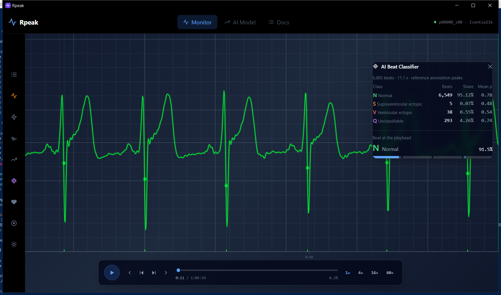

# Packaging: the desktop app

Status: **builds, installs, and verified by driving the real executable.**
`rpeak.exe` + `WebView2Loader.dll` → `Rpeak_0.1.0_x64-setup.exe` (1.31 MiB).



The screenshot is a desktop capture of `target\release\rpeak.exe`, not the
browser build: the classifier panel is open on `p00000_s00` and the transport bar
is fully visible because the window was sized to the work area.

## What G6 actually changes

The UI was already a working Vite app. A desktop build is not "wrap it in a
webview": two things break the moment there is no Node server behind it, and
both are silent if you only check that the window opens.

1. **The dataset is served by Vite middleware.** `vite.config.ts` mounts
   `D:\Rpeak-Desktop\data` at `/data` with range support. A packaged app has no
   middleware, so every `fetch("/data/...")` fails. The fix is a Rust command
   that reads bytes from disk, and one module on the frontend that chooses
   between the two hosts.
2. **The dataset is not inside the bundle.** It is 1.1 GB and carries its own
   licence (CC BY-NC-SA). It has to be found on the user's disk, which means a
   search order and an error message that says where the app looked.

Everything else — playback, detection, delineation, HRV, the CNN — runs
unchanged, because none of it touches the network or the filesystem.

## Toolchain: Rust GNU, and why

This machine has no Rust, no MSVC, and a shell without administrator rights.
Tauri's documented Windows setup is the MSVC toolchain plus Visual Studio Build
Tools, and installing those needs elevation.

`rustup` can install `x86_64-pc-windows-gnu` into the user profile with no
administrator rights, and the GNU target ships its own linker (ld from
mingw-w64) inside the toolchain directory. A trivial `cargo build` was used to
confirm it links and runs before committing to a Tauri build.

Setup, once:

```
rustup-init.exe -y --profile minimal \
    --default-host x86_64-pc-windows-gnu \
    --default-toolchain stable-x86_64-pc-windows-gnu \
    --no-modify-path
```

`--no-modify-path` is deliberate: this shell does not inherit PATH changes, so
the build commands prefix `PATH="$HOME/.cargo/bin:$PATH"` explicitly rather than
relying on a machine-wide setting that a fresh terminal would not see either.

What this costs: the GNU toolchain is not what the Tauri project tests on
Windows. It built cleanly here, but a future Tauri or `windows` crate release
may hit an MSVC-only path first. If that happens, the answer is to install
Visual Studio Build Tools and switch the default host to
`x86_64-pc-windows-msvc`; nothing in this repository depends on the GNU target.

### The linker bug this toolchain exposed

`tauri dev` failed to link while `tauri build` succeeded:

```
ld.exe: error: export ordinal too large: 87595
```

Tauri's template declares `crate-type = ["staticlib", "cdylib", "rlib"]` for the
iOS and Android targets. A **debug** `cdylib` on mingw produces an export table
larger than the PE format allows (65,535 ordinals). Release builds survive
because LTO and `strip` shrink the symbol table enough to fit.

`Cargo.toml` therefore narrows the crate types to `["rlib"]`. Nothing is lost:
the mobile targets are not built here, and the desktop executable links against
the rlib. Restoring them means moving to MSVC, which has a different export
mechanism. The comment in `Cargo.toml` records the same thing next to the line
it explains.

## The window is sized to the screen, not to the design

`tauri.conf.json` asks for 1400×880 logical pixels, which is right on a
1920×1080 display at 100% and wrong almost everywhere else. On the 1920×1080
display at 125% that this was built on, the window becomes 1750×1100 physical
pixels against a 1042-pixel work area: Windows anchors it at the top-left and the
bottom 58 pixels — the transport bar, the control the whole app is driven with —
land off the screen.

The failure is hard to see because the _page_ is fine. The DOM is 1400×880, no
element overflows, and a DevTools screenshot renders the transport perfectly. The
error is in the window, which is the one thing a page-level check cannot inspect.

`fit_to_work_area` in `src/lib.rs` clamps the window to `Monitor::work_area`,
which already excludes the taskbar, minus the frame (`outer_size - inner_size`,
because `set_size` sizes the client area). The window is created with
`"visible": false` and shown after the resize, so a small screen never flashes a
full-size window and then jumps.

Verified on this machine by screenshotting the desktop, not the page: 1768×1042
inside a 1920×1042 work area, transport visible.

Note that PowerShell and other non-DPI-aware processes misreport this screen as
1536×864 — they are shown a virtualised coordinate space. Query the process's
DPI awareness, or make the measuring shell DPI-aware, before believing a
window-rectangle measurement.

## Finding the dataset

`src-tauri/src/lib.rs::resolve_root` tries, in order:

1. `RPEAK_DATA_DIR`, if set and a directory.
2. `<exe dir>\data` — the portable layout: copy the folder beside the exe.
3. `%LOCALAPPDATA%\Rpeak\data` — where an installed copy naturally keeps 1 GB
   of ECG, without touching Program Files.
4. `..\..\data` from `CARGO_MANIFEST_DIR` — **debug builds only**, so
   `npm run desktop` works with no configuration.

A release binary built elsewhere cannot use arm 4: the path is baked in at
compile time and guarded by `cfg!(debug_assertions)`.

When nothing is found, the app does not exit. It renders, shows "Cannot load the
dataset", names the folder it searched, and tells the user what to do. That
state was tested by running the exe in an empty directory with no environment
variable and no per-user folder — the failure a first-time user would hit.

The dataset is deliberately **not** bundled into the installer. 1.1 GB is not a
reasonable download, and redistributing Icentia11k inside an installer is a
licensing question this project should not answer by accident. The cost is that
a fresh install shows the "no dataset" state until the folder is placed; that
trade-off is stated here rather than hidden.

## Reading the dataset over IPC

`app/src/lib/dataset.ts` is the only module that knows which host it is on:

```
browser  → fetch(`${DATA_BASE}/${path}`)
Tauri    → invoke("read_dataset", { path })
```

`read_dataset` returns `tauri::ipc::Response`, which crosses the boundary as
binary rather than a base64 JSON array — the 4 MB signal files are read once per
segment and base64 would cost a third again in size and a decode pass.

The command rejects any path with a `..`, a root, or a drive prefix before
touching the filesystem, then canonicalises and checks the result is still
inside the data root. The second check is what catches a symlink pointing out of
the folder; the first is what keeps the error message simple.

`IS_TAURI` is `"__TAURI_INTERNALS__" in window`, which Tauri injects before any
application script runs. The `@tauri-apps/api` import is dynamic, so the browser
bundle never loads it.

## Verifying the packaged app

`npm run smoke` drives the _browser_ build and proves nothing about the shipped
exe. `npm run smoke:app` starts the real executable, attaches to its WebView2
instance over the DevTools protocol, and asserts against the rendered DOM:

| check                                            | what it catches                                          |
| ------------------------------------------------ | -------------------------------------------------------- |
| the packaged app offers the language switch      | a binary built before the i18n work                      |
| the packaged app ships in Vietnamese             | a stale exe, or a default that silently moved to English |
| pressing EN switches the packaged app to English | the dictionary missing from the bundle                   |
| the monitor renders                              | a blank window                                           |
| the navbar names the segment                     | the catalogue never loaded                               |
| the canvas has painted pixels                    | a trace that never drew                                  |
| the classifier rail entry exists                 | a broken render tree                                     |
| every beat is classified                         | the model file or the IPC path failing                   |
| the packaged app renders the AI Model page       | a page whose artefacts are missing from the bundle       |
| the packaged app renders the Docs page           | the same, for the guide                                  |

It cannot use `window.__rpeak`: that handle is compiled out of release builds,
which is exactly what is under test. So the checks read `document.body.innerText`
and sample the canvas instead. The navbar label carries a `data-dataset-label`
attribute for the same reason.

The canvas check polls. The first version sampled once, at the moment the canvas
element appeared but before the first frame was painted, and reported a working
app as broken — the same mistake the browser smoke test was written to avoid.

Measured on `p00000_s00`: 6,885 beats in 9.2–10.2 s after the G9 retrain (1.34–1.48
ms per beat), against the browser build's 0.95–1.3 ms measured in the same
session on the same machine. The packaged figure is slower because WebView2 is a
different JIT and the app is competing with the dev server for the same cores;
the point of the check is that classification completes inside the packaged app,
not the millisecond. The G15 rebuild measured 6,885 beats in 6.8 s on the final
binary (12.3 s on an earlier run while the dev server was also compiling), which
is the same order and not a regression.

The first three checks are the ones that took a rebuild to pass. They were
written after a run against a two-day-old exe: on that binary the app was
English-only and had no switch, so "pressing EN switches the app to English"
passed without anything being switched — the check was looking for English in an
app that had never left it. They now require the packaged app to _start_ in
Vietnamese and to _leave_ Vietnamese when EN is pressed. Both halves are needed;
either one alone can be satisfied by a build that does nothing.

Note what this does **not** cover: it drives the page, so it passes whether or
not the window fits the screen. That is why the sizing fix above was verified
with a desktop screenshot instead.

## Icons

`npm run icons` runs `app/scripts/make-icons.py`, which draws a QRS complex on a
rounded indigo tile with Pillow at 4× supersampling and writes the whole set
(`icon.ico` with 16–256 px entries, plus the PNGs Tauri wants). The mark is code
rather than an opaque binary, so it can be re-derived at any size.

## Licensing

Two licences, because the project is two kinds of thing.

The code — `app/`, `pipeline/`, `docs/` — is **MIT** ([LICENSE](../LICENSE)).
The ECG data and the classifier weights trained on it are **not**: Icentia11k
is CC BY-NC-SA 4.0, so `data/models/*.pt` and `*.json` are a derivative of it
and carry the same non-commercial, share-alike terms. [NOTICE](../NOTICE) spells
out which is which, what "share-alike" means for a build that ships the weights,
and the MIT-licensed WFDB package the GQRS port in `src/lib/detect/gqrs.ts`
follows (verified against the installed `wfdb` 4.3.1, whose metadata says MIT).

The practical consequence is the same one that keeps the dataset out of the
installer, above: a binary that embeds the weights is a non-commercial build,
and the licence travels with it. The app itself, built without `data/`, is MIT.

The `data/` tree is not in the repository — see
[README.md](README.md#dataset-facts) for how it is reproduced — so the initial
commit carries the licence split but none of the licensed material.

## What is not done

- **No code signing.** The installer is unsigned, so Windows SmartScreen will
  warn on first run. Signing needs a certificate this project does not have, so
  the step is documented rather than attempted — there is nothing to verify
  without a key.
- **The WebView2 runtime is a prerequisite.** It ships with Windows 11 and with
  recent Windows 10 updates, and this machine has it. The bundle uses Tauri's
  default `downloadBootstrapper`, which fetches it when missing; that path was
  not exercised here because the runtime is already present, and it cannot be
  exercised without a machine that lacks WebView2.
- **Silent install was verified, the UI path was not.** `/S` was run end to end
  and the installed app passed every check. The interactive wizard was not
  clicked through.
- **One platform.** Windows x64 only. The same source builds for macOS and Linux
  with their own toolchains; nothing here was tried, and a claim that it "should
  work" is not a measurement.

## Reproducing

```
cd app
npm run icons                        # regenerate icons (only after changing the mark)
npm run desktop                      # dev window against the repo dataset
npm run package                      # rpeak.exe + NSIS installer
npm run smoke:app                    # drive the packaged exe
npm run smoke:app -- --no-data-env   # same, but let the app find the dataset itself
```

To look at the window as the desktop shows it — the only way to catch a
sizing bug — start the exe and capture the window:

```
cd app
RPEAK_DATA_DIR=../data ./src-tauri/target/release/rpeak.exe &
powershell -ExecutionPolicy Bypass -File scripts/shot-window.ps1 -Out ../logs/window.png
```

`shot-window.ps1` calls `SetProcessDPIAware` before it measures anything. Without
that, Windows hands a non-aware process a virtualised 1536×864 for a 1920×1080
screen and the capture comes back downscaled — which is what made a correctly
sized window look clipped during this milestone.

`cargo` is not on the machine's PATH (rustup was installed with
`--no-modify-path`), so from Git Bash the build commands need
`export PATH="$HOME/.cargo/bin:$PATH"` first.

Without it, `npx tauri build --no-bundle` prints
`failed to run 'cargo metadata' ... program not found` and still exits **0** —
the wrapper runs `npm run build` first, and that succeeds, so the exit status is
the build's and not Tauri's. `smoke:app` then drives whatever old exe is on disk.
Check the file's timestamp, not the exit code, after a packaging run.

Artefacts land in `app/src-tauri/target/release/`:

```
rpeak.exe                        3.25 MiB
WebView2Loader.dll              157 KiB
bundle/nsis/Rpeak_0.1.0_x64-setup.exe   1.31 MiB
```
